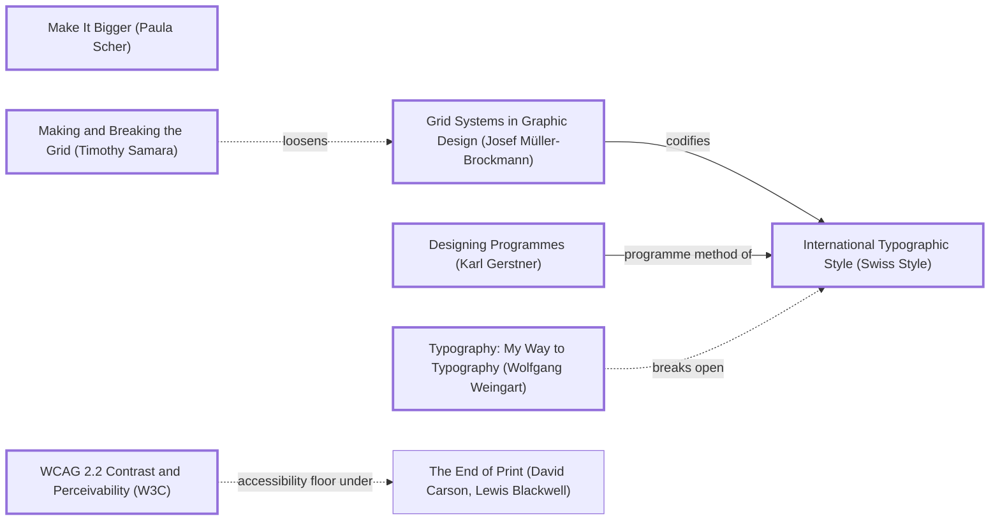
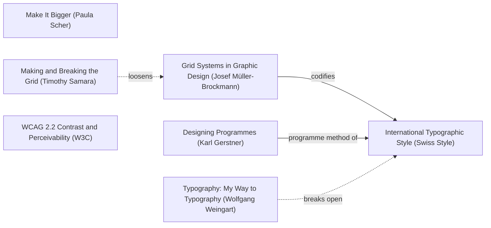

# DESIGN-LOG: LearnC, "C and the languages that grew from it"

DADA run, 2026-11-11. Repo: SolutionsAsService/LearnC, branch `claude/c-language-site-redesign-mbiose`.

## 1. Traversal Plan

**Brief, one sentence:** turn a nine-file C examples repo into a beautiful multi-page website about C and its family (C++, Objective-C, C#, HolyC), and add it to the portfolio and the coding roadmap.

**Mode: Adaptive.** The site serves a public of learners. MAYA governs: the advanced pole is the hero drawn in C's own notation; the acceptable pole is a plain lesson path with code and output side by side.

**Run type: Full.** New work and a redesign: the inherited artifact is a README, not a site.

**Owner's words:** "Need to design full aesthetic beautiful site all about c and other c types cpp holy c objective c etc revamp repo with dada. Add to portfolio and coding roadmap." No bound was given.

### Tooling inventory (Step 0)
| Job | Tool used |
|---|---|
| Anchor graph | Mermaid text in this log (no diagram renderer available) |
| Frontier | grep over `references/anchor-graph.md` edge lines |
| Workflow state | this log's checklist |
| Panel | Agent tool, one general-purpose agent per reference, at most three at a time, each filing to `panel/R<n>/` |
| Collect panel | `ls panel/R<n>/` (the `collect_panel.py` script was not run) |
| Choose panel | `scripts/pick_panel.py --mode adaptive --run-type full --project learnc` |
| Brief seats | `seats/<seat_id>.md` prompt templates |
| Measure | Playwright and Chromium (`_src/measure.mjs`), gcc/g++/clang/mcs at build (`_src/build.py`) |
| Record the run | not imported: the dada repo's ledger scripts were not run in this session |

### Seed (labels copied from the graph)
- Stance: **Make It Bigger (Paula Scher)**
- Rule: **Grid Systems in Graphic Design (Josef Müller-Brockmann)** --codifies--> **International Typographic Style (Swiss Style)**
- Rule: **Designing Programmes (Karl Gerstner)** --programme method of--> **International Typographic Style (Swiss Style)**
- Breaker: **Making and Breaking the Grid (Timothy Samara)** -.loosens.-> Grid Systems in Graphic Design (Josef Müller-Brockmann)
- Counterpoint (dotted): **Typography: My Way to Typography (Wolfgang Weingart)** -.breaks open.-> International Typographic Style (Swiss Style)
- Floor: **WCAG 2.2 Contrast and Perceivability (W3C)**, reached via `crit_inc_mace -->|measures access with| wcag`

Chain: Make It Bigger (Paula Scher) → Grid Systems in Graphic Design (Josef Müller-Brockmann) --codifies--> International Typographic Style (Swiss Style) <--programme method of-- Designing Programmes (Karl Gerstner); Making and Breaking the Grid (Timothy Samara) -.loosens.-> Grid Systems; Typography: My Way to Typography (Wolfgang Weingart) -.breaks open.-> International Typographic Style.

### Panel (from `pick_panel.py`, copied)
| Seat | Why |
|---|---|
| Critic: Provocateur (Debord) | required by the adaptive panel minimum |
| Critic: Provocateur (Shklovsky) | required by the adaptive panel minimum |
| Critic: Inclusion (Holmes) | required by the adaptive panel minimum |
| Critic: Inclusion (Mace) | required by the adaptive panel minimum |
| Critic: Evidence (Cairo) | required: the artifact can be inspected |
| Critic: Usability (Krug) | rated 0.833 over 65 rounds |
| Critic: Craft (Bringhurst) | rated 0.727 over 33 rounds |
| Critic: Aestheticist (Pater) | rotation seat |

Dotted pairs: Debord and Krug; Shklovsky and Krug. Content-owner witness: none. The languages are public standards; facts are checked against the compilers in this container and against primary sources linked on each page.

### R0 premortem (inherited repo, commit f830dbe)
Seats: Cairo, Krug and Debord. Evidence is in `panel/R0/EVIDENCE.md`, and the reports are in `panel/R0/`.

### Panel, WHOLE, round R0 (artifact examined: repo at f830dbe)
| Critic | Anchor used | Observed in the work | Verdict PASS/OBJECT | Requested change |
|---|---|---|---|---|
| Critic: Evidence (Cairo) | How Charts Lie (Alberto Cairo) | README:15-17 stops inside an open fence; `-Wpedantic` warns on `%p`; float 5.9; read_file bug | OBJECT | finish the compile steps; state the flags; `int ch`; double; output plus compiler on every page |
| Critic: Usability (Krug) | Don't Make Me Think (Steve Krug) | no compile command; `functions/` dead end; no output shown | OBJECT | a copy-paste command; a numbered lesson list; output beside code; prev/next |
| Critic: Provocateur (Debord) | The Society of the Spectacle (Guy Debord) | README promises folders and steps it does not have; CONTRIBUTING mentions tests and data that do not exist | OBJECT | cut every unbacked claim; no page names a language without a compiled, run example |

Statements of meaning: a promise of a C course that delivers nine toy programs and an unfinished README.
Andon pulled: no.

| Finding | Resolution |
|---|---|
| Krug + Cairo + Debord: "README cut off, no compile command" | ADAPT (M1): every lesson page and the README give the exact command and flags |
| Krug + Cairo + Debord: "`functions/` listed but missing" | ADAPT (M1): numbered lessons generated from `examples/`, so the list cannot drift |
| Krug + Cairo: "no output shown" | ADAPT (M1): `_src/build.py` compiles and runs every example and prints its real output beside it |
| Cairo + Debord + Krug: "read_file.c char/EOF bug; example.txt missing" | ADAPT (M1): `int ch`; the program writes its own file; the bug is taught on lesson 09 |
| Cairo + Debord: "%p with int* warns under -Wpedantic" | ADAPT (M1): all C compiled with `-Wpedantic -Wstrict-prototypes -Wconversion`, 0 warnings, checked at build |
| Cairo: "float 5.9 is 5.9000001" | ADAPT (M1): `double` |
| Cairo + Debord: "CONTRIBUTING mentions tests and data that do not exist" | ADAPT (M1): CONTRIBUTING rewritten to match the repo |
| Debord: "no page may name a language until a compiled, run example exists" | ADAPT (M1) for C++, Objective-C and C#. For HolyC: OVERRULE in part, with the reason: Adaptive (the acceptable pole is a newcomer seeing the family as it is), and HolyC is the brief's named member. Building a HolyC compiler from external code was refused in this session, so every HolyC sample is labelled **not run here** on the page and in the hero, with a link to where it does run (holyc.shadw.app, TempleOS) |

## Frontier
| Candidate | Reached via (edge label, direction) | From anchor | Status |
|---|---|---|---|
| R0 objections (all above) | Andon / premortem | n/a | TAKEN (M1) |
| Programme: every page generated from one rule and data | programme method of, out | Designing Programmes (Karl Gerstner) | TAKEN (M1) |
| 80-column character grid | codifies, out | Grid Systems in Graphic Design (Josef Müller-Brockmann) | TAKEN (M2) |
| Hero drawn in C's own notation, arrows crossing the grid | loosens, dotted | Making and Breaking the Grid (Timothy Samara) | TAKEN (M3) |
| Type that breaks the Swiss calm (giant glyph) | breaks open, dotted | Typography: My Way to Typography (Wolfgang Weingart) | TAKEN (M3, the giant C in the hero box) |
| Split into pages | Full-run website rule | n/a | TAKEN (M4) |
| Contrast floor on five language colours | accessibility floor, dotted | WCAG 2.2 Contrast and Perceivability (W3C) | TAKEN (M2, measured) |

## Move M1: The programme: compiled truth (KEEP-THE-RULE)
Depends on: none
Anchors: Rule Designing Programmes (Karl Gerstner) | Rule International Typographic Style (Swiss Style)
Intent: every page is the output of one rule applied to the `examples/` tree. A page shows the code, the exact command, the compiler version and the real output. Nothing is typed by hand.
Formal argument: claim: a learning site's authority is its outputs. Grounds: R0 found three claims the repo could not back. Warrant: Gerstner's programme makes a design a rule, not a set of instances, so a new example becomes a correct page with no new design work.
Alternatives rejected: (1) hand-written outputs in Markdown: they drift, which is exactly the README failure R0 found; (2) a JS playground compiling C in the browser: heavy, and it would hide the real toolchain.
Consequence: the build needs gcc, g++, clang with libobjc, and mono. Without them it falls back to the cached `_src/runs.json` and says so.
Fence: none broken.
Frontier effect: the hero's figures (lines, ran or not) can be computed.
Mode field: Advanced pole: a programme in Gerstner's sense. Acceptable pole: a code block and an output block, the most familiar shape in programming education (Krug).

## Move M2: An 80-column page (KEEP-THE-RULE)
Depends on: M1
Anchors: Rule Grid Systems in Graphic Design (Josef Müller-Brockmann) | Counterpoint WCAG 2.2 Contrast and Perceivability (W3C)
Intent: the text column is 80 characters of the monospace face, the width of a terminal and a punch card. Prose in a serif (Newsreader) runs at that measure; code in JetBrains Mono fits it with no sideways scroll for lines up to 80 characters.
Formal argument: Müller-Brockmann derives the grid from the type. Here the type is a terminal's, so the module is one character cell.
Alternatives rejected: (1) a 12-column fluid grid: generic, and unrelated to the subject; (2) full-bleed code: long lines become unreadable.
Consequence: language colours must pass 4.5:1 on both themes.
Fence: none broken.
Frontier effect: the hero can break this grid deliberately (M3).
Mode field: Advanced pole: the grid module is the subject's own unit. Acceptable pole: a 70 to 80 character measure is ordinary good reading (Bringhurst).

## Move M3: The hero is a pointer diagram (BREAK)
Depends on: M1, M2
Anchors: Stance Make It Bigger (Paula Scher) | Breaker Making and Breaking the Grid (Timothy Samara) | Counterpoint Typography: My Way to Typography (Wolfgang Weingart) (dotted edge from International Typographic Style (Swiss Style))
Intent: the landing graphic maps the whole site in C's own notation. Each language is a `struct` box (year, author, hello-world lines, whether it ran here). Its `parent` field is a pointer arrow to C. C points to B, B points to BCPL, and BCPL's parent is NULL. The C lessons are an array `lessons[12]` and the rosetta page is an array `rosetta[5]`. Every box and every cell is a link. The arrows leave the 80-column grid and span the full width.
Formal argument: Samara: a grid is broken legibly only when the break carries meaning. Here the arrows are the meaning: descent is a pointer. Weingart's counterpoint, which breaks open the Swiss calm, is the oversized C glyph in the root box.
Alternatives rejected: (1) a timeline chart: it shows one topic, not the site; (2) six cards in a row: not a form; (3) a family tree with lines: generic, and not in the subject's notation.
Consequence: a dense diagram must stay legible on a phone, so a second, vertical drawing is made for narrow screens.
Fence: the 80-column grid exists for reading. The hero is not read line by line; it is scanned. Lessons and prose stay on the grid.
Frontier effect: the legibility probe (trace C++ → parent → C); the phone version must fit 375 x 812.
Mode field: Advanced pole: Samara and Scher, with notation as image. Acceptable pole: anyone who has seen a box-and-arrow diagram can read it; each box is a labelled link (Krug).

## Move M4: Many pages (KEEP-THE-RULE)
Depends on: M1
Anchors: Rule Designing Programmes (Karl Gerstner)
Intent: home, C overview plus 12 lessons, one page each for C++, Objective-C, C# and HolyC, Rosetta, Family and About, all under shared navigation.
Alternatives rejected: one long page, which fails the trunk test (Krug, R0 F5); a page per example for every language, which spreads thin content across too many pages.
Mode field: Advanced pole: a programme yields the pages. Acceptable pole: ordinary site navigation.

### Panel, WHOLE, round R1 (artifact examined: site at commit 1c7057f, served locally; screenshots in panel/shots; evidence in panel/R1/EVIDENCE.md)
| Critic | Anchor used | Observed in the work | Verdict PASS/OBJECT | Requested change |
|---|---|---|---|---|
| Critic: Evidence (Cairo) | How Charts Lie (Alberto Cairo) | every hero and Rosetta figure reproduced; "every warning switched on" false for C++/ObjC; Root.h/.m not counted; phone arrows end on lesson cells; "1984 · Stepstone"; ARM failure was simulated | OBJECT | name the flags; caption the table; fix the narrow arrows; PPI; say "simulated" |
| Critic: Usability (Krug) | Don't Make Me Think (Steve Krug) | five-second test and legibility probe pass at 1280; at 375 four nav items hidden; child arrows land on lesson cells; no visible first action | OBJECT | wrap the nav; route the arrows to C's border; add a "start" link |
| Critic: Provocateur (Debord) | The Society of the Spectacle (Guy Debord) | hero figures are computed (a claim, not a brochure); "Nothing here is typed by hand"; a hard-coded "(0 warnings)"; meta descriptions include HolyC; footer hides the cache; ".NET runs them unchanged" untested | OBJECT | narrow each claim to what the build backs |
| Critic: Inclusion (Mace) | The Universal Design principles (Ronald Mace) | lesson cells 25.7×21 px at 375; forced-colours band rule loses on specificity; current page invisible in forced colours; nav hidden | OBJECT | ≥24 px cells; fix specificity; underline current page; wrap the nav; Highlight focus |
| Critic: Inclusion (Holmes) | Mismatch (Kat Holmes) | run-on accessible names on hero nodes; links inside role=img; hero premise in C syntax only; jargon in lessons 01–03 | OBJECT | aria-labels; role=group; a plain-language key; gloss terms |
| Critic: Provocateur (Shklovsky) | Art as Technique (Viktor Shklovsky) | hero defeats automatic perception (F1), but the notation stops at the door: inner pages are a habitual docs column, the Pointers lesson draws nothing, and the phone drops C's lessons wire | OBJECT | carry the notation inward: lessons[i] kickers, a struct header per language, a memory diagram on lesson 07, restore the wire |
| Critic: Craft (Bringhurst) | The Elements of Typographic Style (Robert Bringhurst) | prose at ~80 characters; h3 smaller than body; "(void" / "*)" break; straight apostrophes; chip padding before punctuation | OBJECT | prose at ~66 characters; larger h2/h3; nowrap code; curly apostrophes; .15em padding |
| Critic: Aestheticist (Pater) | The Renaissance, Conclusion (Walter Pater) | the 1280 landing "burns"; dark-mode bands go pastel; the phone wire cuts text; dull band under the hero; the HolyC page is grey prose | OBJECT | saturated bands; route the wire clear of text; give the foot weight; one strong moment on HolyC |

Statements of meaning: the family drawn as memory. The landing is a claim the build computes. The inner pages had not yet learned the notation.
Andon pulled: no. Dotted pair present: Krug and Debord.

| Finding | Resolution |
|---|---|
| Krug + Cairo + Mace + Holmes + Pater: "phone hero: arrows land on lesson cells / cells under 24 px / a wire cuts the text" | ADAPT (M5): the narrow drawing is rebuilt. `lessons[12]` is its own array outside C (2×6 cells, 39×30 viewBox units, 37×29 px at 375), restored as a wire from C.lessons. Children enter C's bottom and right borders through gutters, and C.parent leaves at x=300, clear of the text |
| Krug + Holmes + Mace: "nav hidden at 375" | ADAPT (M5): at ≤760 px the nav wraps onto two rows and the header is not sticky |
| Krug: "no visible first action" | ADAPT (M5): "Start with lesson 01 →" beside the headline at 1280, and under the hero on phones |
| Debord + Cairo: "every warning switched on" | ADAPT (M6): C++ and Objective-C are now also built with `-Wpedantic -Wconversion` (0 warnings measured), and the home page names the flags |
| Debord: "Nothing here is typed by hand" | ADAPT (M6): now "No output here is typed by hand" |
| Debord: "hard-coded (0 warnings)" | ADAPT (M6): computed from runs.json |
| Debord: "meta descriptions include HolyC" | ADAPT (M6): they now say "every C, C++, Objective-C and C# example" |
| Debord: "footer hides the cache" | ADAPT (M6): the footer and About print the date of the last compile; About explains `--no-run` and the cache; stale entries are pruned when a language is re-run |
| Debord: ".NET runs them unchanged" | ADAPT (M6): replaced with "They were not tested on Microsoft's .NET" |
| Debord + Cairo: "ARM failure measured / -Wconversion unproven" | ADAPT (M6): "reproduced with gcc 13 on x86 … simulated with -funsigned-char". `-Wconversion` re-measured: the warning is quoted on the page |
| Cairo: "Root.h/.m not counted; comments included" | ADAPT (M6): the table caption says both and gives the computed Root line count |
| Cairo: "1984 · Stepstone" | ADAPT (M6): "1984 · PPI", and the history says "later renamed Stepstone" |
| Cairo: "375x667 leaves rosetta below the fold" | DEFERRED: the rule's sizes are 1280x800 and 375x812. At 812 the hero now ends at 768. At 667 the C box, the lessons array and the first row of children are visible, and the rest is one swipe away |
| Mace: "forced-colours band rule loses on specificity" | ADAPT (M5): `svg .node .band, svg a.node .band { fill: CanvasText }`, plus Canvas/CanvasText for boxes and text and Highlight for focus |
| Mace: "current page invisible in forced colours" | ADAPT (M5): a 3px underline, and a border in forced colours |
| Mace: "lesson-top C link 8×17 px" | ADAPT (M5): padded to a 24 px minimum |
| Holmes: "run-on accessible names" | ADAPT (M5): each node has an aria-label ("C++: year 1985 · Bell Labs, by Bjarne Stroustrup, hello 4 lines · ran ✓"); cells are "C lesson 7: Pointers" and "Rosetta: Swap in five languages" |
| Holmes: "links inside role=img" | ADAPT (M5): the hero and language struct SVGs are role=group |
| Holmes: "premise stated only in C syntax" | ADAPT (M5): the key under the hero glosses struct, pointer, [12] and NULL in plain words |
| Holmes: "jargon in lessons 01–03" | ADAPT (M6): declaration, shell, C23, the output box, byte, float/double and %.2f are glossed; const char * points forward to lesson 10; "original example" is gone |
| Shklovsky: "notation stops at the door" | ADAPT (M7): lesson kickers read `lessons[6]`; Rosetta rows read `rosetta[i]`; each language page opens with its own struct box wired to C |
| Shklovsky: "Pointers lesson draws nothing" | ADAPT (M7): lesson 07 draws num/ptr, then *ptr = 42, then swap's a and b, as boxes and wires |
| Shklovsky: "Rosetta table is a stat-tile habit" | OVERRULE (Adaptive criterion: the table is the page's only computed figure, and Cairo reproduced every cell; the acceptable pole needs a summary). The rows now carry `rosetta[i]` |
| Bringhurst: "prose ~80 characters" | ADAPT (M8): prose is capped at 29em (about 66 characters); code keeps 80 columns |
| Bringhurst: "h3 smaller than body" | ADAPT (M8): h2 1.6rem, h3 1.25rem |
| Bringhurst: "(void / *) break" | ADAPT (M8): inline code under 25 characters never breaks; longer spans (commands) may wrap |
| Bringhurst: "straight apostrophes" | ADAPT (M8): apostrophes are curly in prose, typeset at build time, and code is untouched |
| Bringhurst: "chip padding" | ADAPT (M8): .15em |
| Bringhurst: "family caption 107 characters" | ADAPT (M8): `.small` is at body size and inside the cap |
| Pater: "dark bands pastel" | ADAPT (M5): bands use the saturated light-scheme colours in both schemes, with paper-coloured text |
| Pater: "dull band under the hero" | ADAPT (M5): the plain-language key plus the start action |
| Pater: "HolyC page is grey prose" | ADAPT (M7): its struct box in HolyC green, wired to C, sits above the prose |

## Move M5: The phone hero, access and the nav (KEEP-THE-RULE)
Depends on: M3. Anchors: Rule WCAG 2.2 Contrast and Perceivability (W3C) | Breaker Making and Breaking the Grid (Timothy Samara).
Intent: the narrow drawing obeys its own notation. Arrows end on borders, never on other links, and nothing crosses text.
Alternatives rejected: (1) shrinking the desktop drawing: 9 px text; (2) dropping the lessons array on phones: Shklovsky F4.
Mode field: Advanced pole: the same notation at both sizes. Acceptable pole: ≥24 px targets and a visible nav.

## Move M6: Claims narrowed to the build (KEEP-THE-RULE)
Depends on: M1. Anchors: Rule Designing Programmes (Karl Gerstner). Every figure in prose is computed, or it is removed.

## Move M7: The notation goes inward (BREAK, an escalation of M3)
Depends on: M3. Anchors: Breaker Making and Breaking the Grid (Timothy Samara) | Counterpoint Typography: My Way to Typography (Wolfgang Weingart).
Intent: inner pages speak the hero's language. There are struct headers, `lessons[i]` indices and a three-step memory drawing on the Pointers lesson.
Alternatives rejected: a diagram on every lesson (noise); none (Shklovsky F2).
Mode field: Advanced pole: the notation is the site's grammar. Acceptable pole: each diagram has a code caption and a plain-language aria label.

## Move M8: Reading measure and typesetting (KEEP-THE-RULE)
Depends on: M2. Anchors: Rule Grid Systems in Graphic Design (Josef Müller-Brockmann). The 80-column module now governs code, and prose takes a 66-character subdivision of it.

### Panel, WHOLE, round R2 (artifact examined: site after M5 to M8; evidence in panel/R2/EVIDENCE.md)
| Critic | Anchor used | Observed in the work | Verdict PASS/OBJECT | Requested change |
|---|---|---|---|---|
| Critic: Usability (Krug) | Don't Make Me Think (Steve Krug) | nav wraps; phone wires land on C's borders; five-second test and probe pass at both sizes | PASS | optional: phone start link above the fold; lighter `lessons[6]` |
| Critic: Provocateur (Debord) | The Society of the Spectacle (Guy Debord) | every count interpolated; lesson 09 reproduced; "Prints 55." prose not checked by the build | PASS | build-check the quoted outputs |
| Critic: Aestheticist (Pater) | The Renaissance, Conclusion (Walter Pater) | dark bands saturated; phone wire clear; key closes the hero; HolyC now opens with a struct | PASS | drop the duplicate kicker; optional wider gutters |
| Critic: Evidence (Cairo) | How Charts Lie (Alberto Cairo) | all 41 runs reproduced; every figure matches; the printed Objective-C command fails as printed (missing -I/-L) | OBJECT | print the command the build runs; say what "lines" counts |
| Critic: Inclusion (Holmes) | Mismatch (Kat Holmes) | hero and phone pass; lesson 03 uses later topics; no setup path; language pages announce the struct twice; %d/%c/%zu unglossed | OBJECT | gloss; a "getting a compiler" note; aria-hide or cut the kicker |
| Critic: Inclusion (Mace) | The Universal Design principles (Ronald Mace) | R1 fixes hold; focus stroke invisible on the C link's band (1.00:1); dark `.start:hover` 1.08:1; `.kw` at .8 opacity 4.2:1 | OBJECT | focus above the band; hover colours; opacity 1; Canvas focus fill in forced colours |
| Critic: Provocateur (Shklovsky) | Art as Technique (Viktor Shklovsky) | the notation goes inward; c/index, lesson 08 and lesson 11 draw nothing; drawing below the code; pager in words; Rosetta cards identical | OBJECT | struct on c/index; draw 08 and 11; drawing above code; `lessons[i]` pager; mark the differences from C |
| Critic: Craft (Bringhurst) | The Elements of Typographic Style (Robert Bringhurst) | measure, caption, code breaking fixed; escaped apostrophes in ledes; h3 1.05× body; Rosetta notes uncapped | OBJECT | typeset `&#x27;`; h3 1.4rem; cap the notes |

Andon pulled: no.

| Finding | Resolution |
|---|---|
| Cairo: "printed Objective-C command fails" | ADAPT (M9): the build now runs, and prints, `-I"$(gcc -print-file-name=include)" … -L"$(gcc -print-file-name=)"`; the printed command was run verbatim in a copy of examples/objc (two programs: outputs match) |
| Cairo: "what does 'lines' count" | ADAPT (M9): stated in the hero key and under the C lesson list |
| Debord: "quoted outputs unchecked" | ADAPT (M9): the build fails if a Rosetta "Prints X." or a quoted output in `QUOTED_OUTPUTS` is missing from the real output |
| Holmes: "lesson 03 uses later topics" | ADAPT (M9): one forward-pointing gloss |
| Holmes: "no setup path" | ADAPT (M9): About › Getting a compiler, linked under every command |
| Holmes + Pater: "duplicate kicker" | ADAPT (M9): the language-page kicker is removed; the struct box carries it, with a one-line key under it |
| Holmes: "%d, %c, %zu, bits unglossed" | ADAPT (M9): glossed on lesson 02 |
| Mace: "focus invisible on band" | ADAPT (M9): a `.frame` rect drawn last; focus is an 8px ink stroke outside the band; Highlight in forced colours |
| Mace: "dark start hover 1.08:1" | ADAPT (M9): `--paper` on `--ink` |
| Mace: "`.kw` opacity" | ADAPT (M9): opacity removed |
| Mace: "forced-colours focus fill" | ADAPT (M9): Canvas fill on hover and focus |
| Shklovsky: "c/index draws nothing" | ADAPT (M10): C's own struct, wired to B |
| Shklovsky: "lessons 08 and 11 draw nothing" | ADAPT (M10): struct memory on 08; heap, then NULL after free, on 11 |
| Shklovsky: "drawing buried below code" | ADAPT (M10): drawings precede the code |
| Shklovsky: "pager in words" | ADAPT (M10): `← lessons[5]` / `lessons[7] →` over the titles |
| Shklovsky: "drop the 'lesson 7 of 12' gloss" | OVERRULE (Adaptive criterion: the acceptable pole; Krug R2 F4 and Holmes ask for more gloss, not less) |
| Shklovsky: "Rosetta cards identical" | ADAPT (M10): lines identical to the C version are dimmed (opacity .45), so each card shows only what its language changes |
| Bringhurst: "escaped apostrophes" | ADAPT (M9): the typesetter matches `&#x27;` too; 0 remain outside code |
| Bringhurst: "h3 scale" | ADAPT (M9): 1.4rem |
| Bringhurst: "Rosetta notes uncapped" | ADAPT (M9): notes sit in `.wrap`, capped at 29em |
| Krug: "phone start link below the fold" | DEFERRED: cell 01 is the first action above the fold; adding the link above the hero pushes the hero's bottom past 812 (measured 811) |
| Pater: "wider phone gutters" | DEFERRED (optional, cosmetic) |

## Move M9: R2 corrections (KEEP-THE-RULE)
Depends on: M5, M6, M8. Anchors: Rule WCAG 2.2 Contrast and Perceivability (W3C) | Rule Designing Programmes (Karl Gerstner). Fixes for measured defects only.

## Move M10: Memory drawn where memory is taught (BREAK, an escalation of M7)
Depends on: M7. Anchors: Breaker Making and Breaking the Grid (Timothy Samara) | Counterpoint Typography: My Way to Typography (Wolfgang Weingart).
Intent: every lesson whose subject is memory draws it before showing the code. The Rosetta page shows difference, not sameness.
Alternatives rejected: a drawing on all twelve lessons (noise on hello and loops); diffs as +/- markers (they read as version control, not as language difference).
Mode field: Advanced pole: the notation as the teaching device. Acceptable pole: every drawing has a code caption and an aria title in plain words.

### Panel, WHOLE, round R3 (artifact examined: site after M9, M10; evidence in panel/R3/EVIDENCE.md)
| Critic | Anchor used | Observed in the work | Verdict PASS/OBJECT | Requested change |
|---|---|---|---|---|
| Critic: Provocateur (Shklovsky) | Art as Technique (Viktor Shklovsky) | memory drawn before it is coded; Rosetta dimming shows difference; table still precedes the cards | PASS | optional: first card above the table; `lessons[i]` numbering on c/index |
| Critic: Evidence (Cairo) | How Charts Lie (Alberto Cairo) | 41 runs, 7 ObjC commands verbatim all reproduce; the apt line does not install clang or libobjc | OBJECT | `apt install gcc g++ clang mono-mcs`; say ObjC was verified on Linux only; correct the evidence |
| Critic: Provocateur (Debord) | The Society of the Spectacle (Guy Debord) | output checks exist but match substrings; setup lines oversell (macOS, "one command") | OBJECT | the clang line; macOS covers C and C++; "How to get one"; whole-line matching |
| Critic: Inclusion (Holmes) | Mismatch (Kat Holmes) | R2 fixes landed; lesson 07 drawings named by code; no path from page to file on disk; "one command" false on Windows; `static`, `%s` unglossed | OBJECT | plain titles; download links; fix the claim; gloss |
| Critic: Inclusion (Mace) | The Universal Design principles (Ronald Mace) | every node's focus frame measures 15.6:1 except Ancestors (no frame; byte-identical focus in forced colours) | OBJECT | add a frame to Ancestors at both sizes |
| Critic: Craft (Bringhurst) | The Elements of Typographic Style (Robert Bringhurst) | scale and measure fixed; one apostrophe after `</code>`; straight quotes in prose; drawing labels 10.8–25.3 px | OBJECT | typeset across elements; code or curly quotes; fixed-scale drawings |

Andon pulled: no.

| Finding | Resolution |
|---|---|
| Cairo + Debord: "apt line lacks clang/libobjc" | ADAPT (M11): `sudo apt install gcc g++ clang mono-mcs`; `dpkg -S` confirms `objc/runtime.h` is in libobjc-13-dev, pulled in by clang |
| Cairo + Debord: "macOS line oversells" | ADAPT (M11): macOS is said to cover C and C++; Objective-C verified on Linux only; C# needs Mono or .NET |
| Debord + Holmes: "'one command' false on Windows" | ADAPT (M11): the link reads "How to get one"; Windows is "two steps" |
| Debord: "substring checks" | ADAPT (M11): whole-line matches; QUOTED_OUTPUTS now hold full output lines (Age: 31, sizeof … = 56 bytes, C# 2000) |
| Cairo: "evidence says y 885" | ADAPT: R4 evidence carries the re-measured value |
| Holmes: "drawings named by code" | ADAPT (M11): titles in words ("ptr holds the address of num; num is 10") |
| Holmes: "no path to a file on disk" | ADAPT (M11): every program has a Download link (examples/ copied into site/), with "open a terminal in the folder… paste the command", and the Objective-C ones name Root.m |
| Holmes: "static, %s" | ADAPT (M11): glossed on lesson 03 |
| Mace: "Ancestors has no focus frame" | ADAPT (M11): `.frame` around both ancestor boxes at 1280 and 375 |
| Bringhurst: "apostrophe after an element" | ADAPT (M11): the typesetter handles text that starts right after `<code>…</code>`; `fgetc`’s now curly |
| Bringhurst: "straight quotes in prose" | ADAPT (M11): string values set as code; "pointer" in curly quotes |
| Bringhurst: "drawing label sizes" | ADAPT (M11): drawings render at 1:1 (width = viewBox width, max-width 100%); memory panels stack. Measured min 12 px across 15 pages × 2 sizes × 2 schemes. An inert attempt is logged: `font-size="16"` on NULL had no effect because the `.null` CSS rule beats a presentation attribute; an inline style moved it |
| Shklovsky: "first card above the table" | DEFERRED (optional; Cairo relies on the table as the page's figure) |

## Move M11: R3 corrections (KEEP-THE-RULE)
Depends on: M9, M10. Anchors: Rule WCAG 2.2 Contrast and Perceivability (W3C) | Rule Designing Programmes (Karl Gerstner).

### Panel, WHOLE, round R4 (artifact examined: site after M11; evidence in panel/R4/EVIDENCE.md)
| Critic | Anchor used | Observed in the work | Verdict PASS/OBJECT | Requested change |
|---|---|---|---|---|
| Critic: Craft (Bringhurst) | The Elements of Typographic Style (Robert Bringhurst) | no straight quotes in prose; labels 15–16 px at 1280; the 12 px floor holds | PASS | optional: reflow 08/11 drawings at phone width |
| Critic: Evidence (Cairo) | How Charts Lie (Alberto Cairo) | rebuild byte-identical; 08 downloaded and run verbatim; Rosetta sum.m fails without ../Root.m and Root.h; 01_messages.m needs Root.h; 15 of 22 pages measured | OBJECT | link Root.h and Root.m and say where; measure all pages |
| Critic: Provocateur (Debord) | The Society of the Spectacle (Guy Debord) | setup claims fixed; ObjC sentence names a file it does not give; "../Root.m, from the same folder" contradicts itself; About's "any program" includes HolyC | OBJECT | links; fix the sentence; except HolyC |
| Critic: Inclusion (Holmes) | Mismatch (Kat Holmes) | R3 findings resolved; Root.m and Root.h not reachable; WSL unglossed | OBJECT | links; gloss WSL |
| Critic: Inclusion (Mace) | The Universal Design principles (Ronald Mace) | Ancestors frame fixed in 6 modes; desktop nav clips focus rings (overflow-x); download line has 0 px leading under "How to get one" | OBJECT | inset outline; line-height on .setup |

Andon pulled: no.

| Finding | Resolution |
|---|---|
| Cairo + Debord + Holmes: "Objective-C downloads incomplete" | ADAPT (M12): `Root.h` and `Root.m` are copied into `examples/objc/rosetta/`, so every Objective-C program compiles with `Root.m` in its own folder. Every Objective-C download line links Root.h and Root.m "beside it". Verified: sum.m, Root.h and Root.m fetched over HTTP into an empty folder, then the printed command pasted verbatim, prints 55; 01_messages.m the same, prints its recorded output |
| Debord: "About's 'any program' includes HolyC" | ADAPT (M12): "any C, C++, Objective-C or C# program" |
| Holmes: "WSL unglossed" | ADAPT (M12): "WSL (a Linux shell inside Windows)" |
| Mace: "desktop nav clips focus" | ADAPT (M12): `outline-offset: -3px` on nav links |
| Mace: "download line leading" | ADAPT (M12): `.setup { line-height: 1.55 }` |
| Cairo: "15 of 22 pages measured" | ADAPT (M12): `measure.cjs` now enumerates every page in site/: 22 pages × 2 sizes × 2 schemes, 0 overflow, min 12 px |
| Bringhurst: "08/11 drawings at phone width" | DEFERRED (optional; 12.3 px is above the floor) |

## Move M12: R4 corrections (KEEP-THE-RULE)
Depends on: M11. Anchors: Rule Designing Programmes (Karl Gerstner) | Rule WCAG 2.2 Contrast and Perceivability (W3C).

## Move M13: S4 ambition push (BREAK escalated)
Depends on: M3. Anchors: Stance Make It Bigger (Paula Scher) | Counterpoint Typography: My Way to Typography (Wolfgang Weingart).
Intent: the root glyph, the hero's boldest element, made bigger once more.
Measured: the C glyph's rendered box went from 98 to 129 px tall (+32%) and 45 to 59 px wide; the band from 67 to 87 px; the hero's bottom stayed at 707 px (1280x800). First attempt: size 104 broke out above the box's top edge (glyph top above the box at y 172) and read as clipping, so it settled at 94, inside the band.

### Panel, WHOLE, round R5 (artifact examined: site after M12, M13; evidence in panel/R5/EVIDENCE.md), plus R5b
| Critic | Anchor used | Observed in the work | Verdict PASS/OBJECT | Requested change |
|---|---|---|---|---|
| Critic: Evidence (Cairo) | How Charts Lie (Alberto Cairo) | ObjC downloads (objc.html, rosetta.html) fetched into empty folders and run verbatim reproduce; rebuild identical; 22×2×2 measured | PASS | label 129 px as "text box at 1280x800" |
| Critic: Provocateur (Debord) | The Society of the Spectacle (Guy Debord) | all 22 pages' claims reproduce; R4 findings resolved | PASS | optional: soften "cannot be silently ignored"; "Root.m allocates…" |
| Critic: Inclusion (Holmes) | Mismatch (Kat Holmes) | downloads complete; WSL glossed | PASS | optional: "save all three in the same folder"; gloss PowerShell, sudo |
| Critic: Provocateur (Shklovsky) | Art as Technique (Viktor Shklovsky) | the struct hero still estranges; the bigger C echoes the logo (size is not estrangement); 50 px at 375 | PASS | optional: make the C strange, not big |
| Critic: Inclusion (Mace), R5 | The Universal Design principles (Ronald Mace) | R4 fixes hold; in dark mode the focus ring touches the enlarged C (1.08:1); the current-page inset ring is 2.09–2.73:1 | OBJECT | frame outside the box; paper ring on current page |
| Critic: Inclusion (Mace), R5b | The Universal Design principles (Ronald Mace) | frames sit outside the boxes with a 2–4 px paper gap; ring 15.3–15.6:1; current-page ring 15.3–15.6:1; no clipping | PASS | none |

Andon pulled: no.

| Finding | Resolution |
|---|---|
| Mace: "focus ring touches the enlarged C" | ADAPT (M14): `outset_frames()` draws every focus frame 6 units outside its box (4-unit stroke; svg overflow visible). Re-judged in R5b: PASS |
| Mace: "current-page ring under 3:1" | ADAPT (M14): `outline-color: var(--paper)` on the current page's focus. Re-judged in R5b: PASS |
| Cairo: "label 129 px as a text box at 1280" | ADAPT: below and in M13 the figure is "text box at 1280x800" (124 px getBBox; 50 px at 375) |
| Shklovsky: "size is not estrangement" | DEFERRED, with reason: the push was S4's required escalation. Making the C a char literal `'C'` is logged as the first candidate for a later Full run |
| Debord F15/F16, Holmes F1/F3, Shklovsky R3 F3/F4, Bringhurst R4 F3, Pater R2 F7, Krug R2 F3/F4 | DEFERRED (each marked optional by its seat) |

## Move M14: R5 corrections (KEEP-THE-RULE)
Depends on: M13. Anchors: Rule WCAG 2.2 Contrast and Perceivability (W3C).

## Frontier (final)
| Candidate | Reached via | From anchor | Status |
|---|---|---|---|
| R0–R5 objections | Andon / panel | n/a | TAKEN (M1–M14) or DEFERRED as listed |
| Programme from data | programme method of | Designing Programmes (Karl Gerstner) | TAKEN (M1, M6) |
| 80-column grid | codifies | Grid Systems in Graphic Design (Josef Müller-Brockmann) | TAKEN (M2, M8) |
| Notation as hero, wires across the grid | loosens (dotted) | Making and Breaking the Grid (Timothy Samara) | TAKEN (M3, M7, M10) |
| Giant glyph | breaks open (dotted) | Typography: My Way to Typography (Wolfgang Weingart) | TAKEN (M3, M13) |
| Contrast floor | accessibility floor under (dotted) | WCAG 2.2 Contrast and Perceivability (W3C) | TAKEN (M5, M9, M11, M14) |
| `'C'` as a char literal instead of a bigger C | Shklovsky R5 | Typography: My Way to Typography (Wolfgang Weingart) | DEFERRED (next Full run) |
| Rosetta first card above the table | Shklovsky R3 | Making and Breaking the Grid (Timothy Samara) | DEFERRED (optional; Cairo relies on the table) |
| Phone start link above the fold | Krug R2 | n/a | DEFERRED (adding it pushes the hero bottom to 811 px at 812) |
| 375x667 fold | Cairo R1 | n/a | DEFERRED (outside the rule's sizes) |
| A HolyC compiler to run the HolyC samples | brief | n/a | DEFERRED: building one from external code was refused in this session |

## 2f. Deletion review and residual diff
Inherited before this run: README (truncated), CONTRIBUTING (made claims about tests and data that did not exist), and nine `.c` files in five folders.
- The nine `.c` files: SCRAPPED as files and kept as content. Each became a lesson in `examples/c/` with its bug fixed. The retained-value ledger records what the deletion had to keep: every original program's behaviour (hello, variables, conditionals, loops, the add function, the array, the pointer, the struct, the file read), and the read_file bug as a lesson.
- Residual diff: variables float→double (intended: 5.90 printed either way); pointers no longer print raw addresses (intended: they varied per run); structs now print 31, not 30, because birthday() was added (intended); read_file writes its own file (intended: it used to exit 1). No regressions: 41/41 exit 0.
- README and CONTRIBUTING: rewritten, with no unbacked claims.

## 2g. Every figure the site displays, re-measured at the final state (after M14, the last edit)
| Printed figure | Procedure | Final value | Status |
|---|---|---|---|
| hello lines 5/4/5/6/2 (hero, language pages) | non-blank lines of examples/<lang>/rosetta/hello.* | 5/4/5/6/2 | reproducible |
| Rosetta totals 39/37/68/42/33 and every cell | same, per program | 39/37/68/42/33 | reproducible |
| Root.h + Root.m "24 lines" | same | 24 | reproducible |
| "41 programs, 0 warnings, 0 failures" (home, About) | `python3 _src/build.py` | 41 / 0 / 0 | reproducible |
| "7 HolyC programs" | count of examples/holyc/**/*.HC | 7 | reproducible |
| lesson line counts on c/index | non-blank lines | match | reproducible |
| "56 bytes", "Age: 31", "111 Collatz steps", "7 chars, 8 bytes", "C# 2000", "C++", "Prints 55/5.0/retniop" | the build's whole-line output checks | pass | reproducible (the build fails otherwise) |
| "compiled on 2026-11-11" | runs.json `built` | 2026-11-11 | reproducible |
| hero bottom 707 / 768 px | `node _src/measure.cjs` | 707 / 768 | reproducible |
| root C glyph | text box at 1280x800 | 129 px (getBBox 124); 50 px at 375 | measured, not printed on the site |

## Stop test
- **S1** met: every Frontier item is TAKEN or DEFERRED, with a reason (Frontier, above).
- **S2** met, with a caveat: every required critic (Cairo, Debord, Holmes, Mace, Shklovsky) PASSED on the final state. Four passed in R5; Mace passed in R5b after an ADAPT that touched only focus styling. The non-required seats passed earlier: Krug and Pater in R2, Bringhurst in R4.
- **S3 NOT met.** Every round from R0 to R5 produced at least one ADAPT. No two consecutive WHOLE rounds were quiet. The run stopped here on the conductor's judgement of cost; that was not saturation.
- **S4** met: M13 pushed the boldest element. Measured: glyph 98→129 px (text box at 1280x800), band 67→87 px, hero bottom unchanged at 707. The push survived R5 after M14 moved the focus frames.
- **S5** met: `samBreak -.loosens-> mb` applied (M3); `weingart -.breaks open-> itstyle` applied (M3, M13); `wcag -.accessibility floor under-> carson` declined, because Carson was never seeded and WCAG is applied as the floor itself; `scher -.contrasts with-> vignelliCanon` and `scher -.identity as environment answers-> wheeler` declined, because the site carries no brand system beyond the C mark.

## Anchor Ledger
| Anchor | Role | Status | Evidence | Note |
|---|---|---|---|---|
| Make It Bigger (Paula Scher) | Stance | KEEP | M3, M13; survived Shklovsky R5 "size is not estrangement" | |
| Grid Systems in Graphic Design (Josef Müller-Brockmann) | Rule | ADAPT | M2: 80 columns for code; M8: 29em prose subdivision after Bringhurst R1 | |
| International Typographic Style (Swiss Style) | Rule | KEEP | the mono/serif system; survived Pater R1 "grey prose" | |
| Designing Programmes (Karl Gerstner) | Rule | KEEP | M1, M6: every page and figure generated; survived Debord R1–R4 | |
| Making and Breaking the Grid (Timothy Samara) | Breaker | KEEP | M3, M7, M10; survived Krug and Mace R1 (phone wires), fixed in M5 | |
| Typography: My Way to Typography (Wolfgang Weingart) | Counterpoint | KEEP | M3, M13; survived Mace R5 (focus), fixed in M14 | |
| WCAG 2.2 Contrast and Perceivability (W3C) | Floor | KEEP | M5, M9, M11, M14 | |

## Double loop
The criterion held: MAYA kept the Rosetta table and the "lesson 7 of 12" gloss against Shklovsky. The panel was the weak part. Measurement seats (Cairo, Mace) found real defects in every round, and the cause was the conductor's evidence files, which twice measured fewer pages than the site has (lessons 08 and 11; then 15 of 22). Each fix also opened a new surface for Mace (focus on bands, then nav clipping, then the enlarged glyph). **Graph amendment:** add an edge `crit_evid_cairo -->|measures every page, not a sample, of| wcag`, and make "the measuring script enumerates the artifact, never a list typed by the conductor" a rule in measurement-checklist.md.

## Carry-Forward Ledger
See `CARRY-FORWARD.md`.

## Compliance Check
- [x] Tooling inventory done (Traversal Plan › Step 0)
- [x] Mode stated with reason (Adaptive, Traversal Plan)
- [x] Panel seated from `pick_panel.py`; seats briefed from `seats/` files; no bound was given
- [x] Seed with exact labels, a dotted counterpoint, a living Frontier
- [x] Run type stated (Full); no freezes apply
- [x] Landing leads with one bold graphic that summarizes every topic (5 languages, lessons[12], rosetta[5], ancestors → Family), complete at 1280x800 (bottom 707) and 375x812 (bottom 768)
- [x] BREAK moves taken (M3, M7, M10, M13); no quota used
- [x] A Decision Record before each move (M1–M14)
- [x] A Panel Report per round (R0–R5b), with each critic citing something observable
- [x] Every OBJECT resolved (ADAPT, OVERRULE or DEFERRED with reason)
- [ ] S3 not met (see Stop test)
- [x] Every displayed figure re-measured at the final state (2g)
- [x] Anchor Ledger and graph updated
- [x] Double-loop paragraph written
- [ ] Run recorded in the dada ledger: see the final reply
- [x] The final reply states the mode, tools, stop conditions and skips
