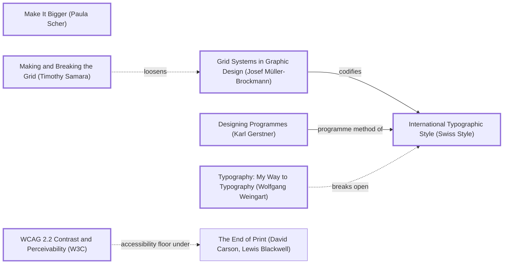

# DESIGN-LOG: LearnC, "C and the languages that grew from it"

DADA run, 2026-11-11. Repo: SolutionsAsService/LearnC, branch `claude/c-language-site-redesign-mbiose`.

## 1. Traversal Plan

**Brief, one sentence:** turn a nine-file C examples repo into a beautiful multi-page website about C and its family (C++, Objective-C, C#, HolyC), and add it to the portfolio and the coding roadmap.

**Mode: Adaptive.** The site serves a public of learners. MAYA governs: the advanced pole is the hero drawn in C's own notation; the acceptable pole is a plain lesson path with code and output side by side.

**Run type: Full.** New work and a redesign: the inherited artifact is a README, not a site.

**Owner's words:** "Need to design full aesthetic beautiful site all about c and other c types cpp holy c objective c etc revamp repo with dada. Add to portfolio and coding roadmap." No bound was given.

### Tooling inventory (Step 0)
| Job | Tool used |
|---|---|
| Anchor graph | Mermaid text in this log (no diagram renderer available) |
| Frontier | grep over `references/anchor-graph.md` edge lines |
| Workflow state | this log's checklist |
| Panel | Agent tool, one general-purpose agent per reference, at most three at a time, each filing to `panel/R<n>/` |
| Collect panel | `ls panel/R<n>/` (the `collect_panel.py` script was not run) |
| Choose panel | `scripts/pick_panel.py --mode adaptive --run-type full --project learnc` |
| Brief seats | `seats/<seat_id>.md` prompt templates |
| Measure | Playwright and Chromium (`_src/measure.mjs`), gcc/g++/clang/mcs at build (`_src/build.py`) |
| Record the run | not imported: the dada repo's ledger scripts were not run in this session |

### Seed (labels copied from the graph)
- Stance: **Make It Bigger (Paula Scher)**
- Rule: **Grid Systems in Graphic Design (Josef Müller-Brockmann)** --codifies--> **International Typographic Style (Swiss Style)**
- Rule: **Designing Programmes (Karl Gerstner)** --programme method of--> **International Typographic Style (Swiss Style)**
- Breaker: **Making and Breaking the Grid (Timothy Samara)** -.loosens.-> Grid Systems in Graphic Design (Josef Müller-Brockmann)
- Counterpoint (dotted): **Typography: My Way to Typography (Wolfgang Weingart)** -.breaks open.-> International Typographic Style (Swiss Style)
- Floor: **WCAG 2.2 Contrast and Perceivability (W3C)**, reached via `crit_inc_mace -->|measures access with| wcag`

Chain: Make It Bigger (Paula Scher) → Grid Systems in Graphic Design (Josef Müller-Brockmann) --codifies--> International Typographic Style (Swiss Style) <--programme method of-- Designing Programmes (Karl Gerstner); Making and Breaking the Grid (Timothy Samara) -.loosens.-> Grid Systems; Typography: My Way to Typography (Wolfgang Weingart) -.breaks open.-> International Typographic Style.

### Panel (from `pick_panel.py`, copied)
| Seat | Why |
|---|---|
| Critic: Provocateur (Debord) | required by the adaptive panel minimum |
| Critic: Provocateur (Shklovsky) | required by the adaptive panel minimum |
| Critic: Inclusion (Holmes) | required by the adaptive panel minimum |
| Critic: Inclusion (Mace) | required by the adaptive panel minimum |
| Critic: Evidence (Cairo) | required: the artifact can be inspected |
| Critic: Usability (Krug) | rated 0.833 over 65 rounds |
| Critic: Craft (Bringhurst) | rated 0.727 over 33 rounds |
| Critic: Aestheticist (Pater) | rotation seat |

Dotted pairs: Debord and Krug; Shklovsky and Krug. Content-owner witness: none. The languages are public standards; facts are checked against the compilers in this container and against primary sources linked on each page.

### R0 premortem (inherited repo, commit f830dbe)
Seats: Cairo, Krug and Debord. Evidence is in `panel/R0/EVIDENCE.md`, and the reports are in `panel/R0/`.

### Panel, WHOLE, round R0 (artifact examined: repo at f830dbe)
| Critic | Anchor used | Observed in the work | Verdict PASS/OBJECT | Requested change |
|---|---|---|---|---|
| Critic: Evidence (Cairo) | How Charts Lie (Alberto Cairo) | README:15-17 stops inside an open fence; `-Wpedantic` warns on `%p`; float 5.9; read_file bug | OBJECT | finish the compile steps; state the flags; `int ch`; double; output plus compiler on every page |
| Critic: Usability (Krug) | Don't Make Me Think (Steve Krug) | no compile command; `functions/` dead end; no output shown | OBJECT | a copy-paste command; a numbered lesson list; output beside code; prev/next |
| Critic: Provocateur (Debord) | The Society of the Spectacle (Guy Debord) | README promises folders and steps it does not have; CONTRIBUTING mentions tests and data that do not exist | OBJECT | cut every unbacked claim; no page names a language without a compiled, run example |

Statements of meaning: a promise of a C course that delivers nine toy programs and an unfinished README.
Andon pulled: no.

| Finding | Resolution |
|---|---|
| Krug + Cairo + Debord: "README cut off, no compile command" | ADAPT (M1): every lesson page and the README give the exact command and flags |
| Krug + Cairo + Debord: "`functions/` listed but missing" | ADAPT (M1): numbered lessons generated from `examples/`, so the list cannot drift |
| Krug + Cairo: "no output shown" | ADAPT (M1): `_src/build.py` compiles and runs every example and prints its real output beside it |
| Cairo + Debord + Krug: "read_file.c char/EOF bug; example.txt missing" | ADAPT (M1): `int ch`; the program writes its own file; the bug is taught on lesson 09 |
| Cairo + Debord: "%p with int* warns under -Wpedantic" | ADAPT (M1): all C compiled with `-Wpedantic -Wstrict-prototypes -Wconversion`, 0 warnings, checked at build |
| Cairo: "float 5.9 is 5.9000001" | ADAPT (M1): `double` |
| Cairo + Debord: "CONTRIBUTING mentions tests and data that do not exist" | ADAPT (M1): CONTRIBUTING rewritten to match the repo |
| Debord: "no page may name a language until a compiled, run example exists" | ADAPT (M1) for C++, Objective-C and C#. For HolyC: OVERRULE in part, with the reason: Adaptive (the acceptable pole is a newcomer seeing the family as it is), and HolyC is the brief's named member. Building a HolyC compiler from external code was refused in this session, so every HolyC sample is labelled **not run here** on the page and in the hero, with a link to where it does run (holyc.shadw.app, TempleOS) |

## Frontier
| Candidate | Reached via (edge label, direction) | From anchor | Status |
|---|---|---|---|
| R0 objections (all above) | Andon / premortem | n/a | TAKEN (M1) |
| Programme: every page generated from one rule and data | programme method of, out | Designing Programmes (Karl Gerstner) | TAKEN (M1) |
| 80-column character grid | codifies, out | Grid Systems in Graphic Design (Josef Müller-Brockmann) | TAKEN (M2) |
| Hero drawn in C's own notation, arrows crossing the grid | loosens, dotted | Making and Breaking the Grid (Timothy Samara) | TAKEN (M3) |
| Type that breaks the Swiss calm (giant glyph) | breaks open, dotted | Typography: My Way to Typography (Wolfgang Weingart) | TAKEN (M3, the giant C in the hero box) |
| Split into pages | Full-run website rule | n/a | TAKEN (M4) |
| Contrast floor on five language colours | accessibility floor, dotted | WCAG 2.2 Contrast and Perceivability (W3C) | TAKEN (M2, measured) |

## Move M1: The programme: compiled truth (KEEP-THE-RULE)
Depends on: none
Anchors: Rule Designing Programmes (Karl Gerstner) | Rule International Typographic Style (Swiss Style)
Intent: every page is the output of one rule applied to the `examples/` tree. A page shows the code, the exact command, the compiler version and the real output. Nothing is typed by hand.
Formal argument: claim: a learning site's authority is its outputs. Grounds: R0 found three claims the repo could not back. Warrant: Gerstner's programme makes a design a rule, not a set of instances, so a new example becomes a correct page with no new design work.
Alternatives rejected: (1) hand-written outputs in Markdown: they drift, which is exactly the README failure R0 found; (2) a JS playground compiling C in the browser: heavy, and it would hide the real toolchain.
Consequence: the build needs gcc, g++, clang with libobjc, and mono. Without them it falls back to the cached `_src/runs.json` and says so.
Fence: none broken.
Frontier effect: the hero's figures (lines, ran or not) can be computed.
Mode field: Advanced pole: a programme in Gerstner's sense. Acceptable pole: a code block and an output block, the most familiar shape in programming education (Krug).

## Move M2: An 80-column page (KEEP-THE-RULE)
Depends on: M1
Anchors: Rule Grid Systems in Graphic Design (Josef Müller-Brockmann) | Counterpoint WCAG 2.2 Contrast and Perceivability (W3C)
Intent: the text column is 80 characters of the monospace face, the width of a terminal and a punch card. Prose in a serif (Newsreader) runs at that measure; code in JetBrains Mono fits it with no sideways scroll for lines up to 80 characters.
Formal argument: Müller-Brockmann derives the grid from the type. Here the type is a terminal's, so the module is one character cell.
Alternatives rejected: (1) a 12-column fluid grid: generic, and unrelated to the subject; (2) full-bleed code: long lines become unreadable.
Consequence: language colours must pass 4.5:1 on both themes.
Fence: none broken.
Frontier effect: the hero can break this grid deliberately (M3).
Mode field: Advanced pole: the grid module is the subject's own unit. Acceptable pole: a 70 to 80 character measure is ordinary good reading (Bringhurst).

## Move M3: The hero is a pointer diagram (BREAK)
Depends on: M1, M2
Anchors: Stance Make It Bigger (Paula Scher) | Breaker Making and Breaking the Grid (Timothy Samara) | Counterpoint Typography: My Way to Typography (Wolfgang Weingart) (dotted edge from International Typographic Style (Swiss Style))
Intent: the landing graphic maps the whole site in C's own notation. Each language is a `struct` box (year, author, hello-world lines, whether it ran here). Its `parent` field is a pointer arrow to C. C points to B, B points to BCPL, and BCPL's parent is NULL. The C lessons are an array `lessons[12]` and the rosetta page is an array `rosetta[5]`. Every box and every cell is a link. The arrows leave the 80-column grid and span the full width.
Formal argument: Samara: a grid is broken legibly only when the break carries meaning. Here the arrows are the meaning: descent is a pointer. Weingart's counterpoint, which breaks open the Swiss calm, is the oversized C glyph in the root box.
Alternatives rejected: (1) a timeline chart: it shows one topic, not the site; (2) six cards in a row: not a form; (3) a family tree with lines: generic, and not in the subject's notation.
Consequence: a dense diagram must stay legible on a phone, so a second, vertical drawing is made for narrow screens.
Fence: the 80-column grid exists for reading. The hero is not read line by line; it is scanned. Lessons and prose stay on the grid.
Frontier effect: the legibility probe (trace C++ → parent → C); the phone version must fit 375 x 812.
Mode field: Advanced pole: Samara and Scher, with notation as image. Acceptable pole: anyone who has seen a box-and-arrow diagram can read it; each box is a labelled link (Krug).

## Move M4: Many pages (KEEP-THE-RULE)
Depends on: M1
Anchors: Rule Designing Programmes (Karl Gerstner)
Intent: home, C overview plus 12 lessons, one page each for C++, Objective-C, C# and HolyC, Rosetta, Family and About, all under shared navigation.
Alternatives rejected: one long page, which fails the trunk test (Krug, R0 F5); a page per example for every language, which spreads thin content across too many pages.
Mode field: Advanced pole: a programme yields the pages. Acceptable pole: ordinary site navigation.
